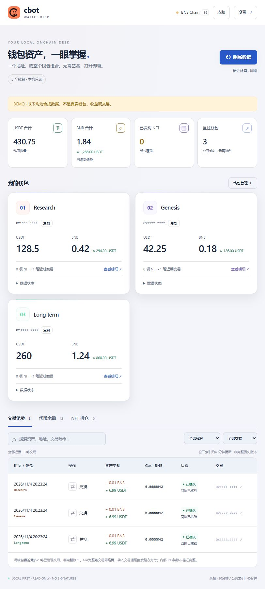

# cbot Wallet Desk

**本地、只读的 BSC 多钱包看板。把下面一段话发给你的 AI agent，环境和部署一起完成。**

无需连接钱包、签名或私钥。支持 Codex、Claude Code、OpenClaw 等具有终端和联网能力的 agent。MIT 开源，非 Binance / ANKR 官方产品。



## 复制给你的 agent

```text
请安装并部署 cbot Wallet Desk v1.1.2：先读取 https://raw.githubusercontent.com/Clorisfj/cbot-wallet/v1.1.2/docs/INSTALL.agent.md ，按说明检查系统、自动安装缺失环境、安装看板并启动后台、核验健康接口并打开页面。请直接完成可自动执行的步骤，只在系统必须由我授权时提示。保留已有钱包和配置，不登录、不签名、不导出凭据，不开放公网端口。完成后告诉我访问地址及如何停止。我会在页面“钱包管理”添加监控地址。
```

不必先装 Node、npm 或 Git。引导脚本复用符合要求的 Node，否则安装官方 Node 24.11.0 便携环境并核对官方 SHA256。Windows 默认创建桌面与登录启动快捷方式；macOS/Linux 启动后台，agent 可按指南配置用户登录自启。受限系统、缺失系统下载/解压工具或管理员策略可能仍需系统授权。云端 agent 部署在云主机，需私有隧道访问本机回环地址。

## 为什么用它

- **一个到多个钱包自适应**：在“我的钱包 → 钱包管理”添加、改名或删除公开 BSC 地址；删除自动识别的钱包不会重新出现。
- **余额更醒目**：BNB / USDT 优先展示，来源和会话细节折叠；交易、代币、NFT 在同一页筛选。
- **减少小额干扰**：自动隐藏零余额，可切换隐藏估值低于 0.1 USDT 的持仓；未报价资产保留。
- **环境一起安装**：无需数据库、构建步骤或运行时 npm 依赖；启动后可保存浏览器书签。
- **免费默认，按需增强**：公共节点直接用；设置中可填自定义 BSC RPC，ANKR BSC 密钥 URL 自动接入索引，无需重复填写 Token。
- **刷新成本可见**：5 / 10 / 15 / 30 / 60 分钟，默认推荐30分钟；按钱包数、已发现代币估算请求消耗。公共索引对多钱包自动降频。
- **皮肤可选**：午夜、深海、晴空，可自选强调色，保存在当前浏览器。
- **本地只读**：无签名、转账、交易或授权入口；数据源故障保留缓存及更新时间，不将失败伪装成零余额。

## 使用

打开 http://127.0.0.1:48765/ → **钱包管理** 添加公开地址。右上角 **设置** 管理 RPC 与刷新间隔，**皮肤** 调整外观。关闭页面不停止后台；电脑仍须开机。

普通 RPC 查询已知合约，索引用于发现合约，二者不等价。公共索引覆盖不完整；交易每钱包最多20笔已发现记录，NFT 为部分发现，参考估值不代表可卖出价格。ANKR Advanced 需对应账户开通，未保证所有密钥套餐均可用。

配置与缓存保存在 `~/.cbot-wallet/`（可用 `CBOT_HOME` 覆盖），不在仓库。完整数据源 URL 只保存在本机且不回显，应用不负责加密，请保护系统账户及备份。数据源会收到查询地址与 IP，NFT 图片可能来自第三方 HTTPS 站点。不要上传真实配置或钱包截图。

## 文档

- [精简中文教程](docs/QUICKSTART.zh-CN.md)
- [Agent 自动安装流程](docs/INSTALL.agent.md)
- [安装、更新与停止](docs/INSTALL.md)
- [数据源与消耗计算](docs/DATA-SOURCES.md)
- [Agent Skill](skills/cbot-wallet/SKILL.md)
- [分享文案](docs/SHARE.zh-CN.md)

## 开发与验证

Node.js 24.5+：`npm test`；合成演示：`npm run demo`。Windows 有部署实测；macOS/Linux 引导脚本需在对应系统完成部署验收，不能视为已实测。CI 模板见 docs/CI.example.yml。

代码使用 [MIT](LICENSE)，允许修改与商用，保留许可证即可；不代表品牌背书。
